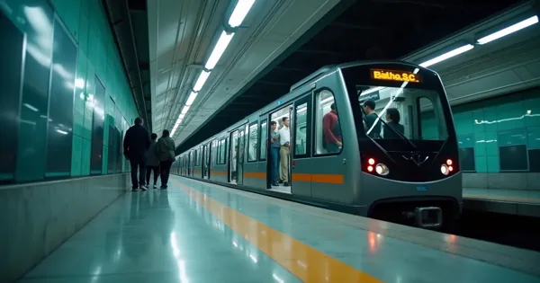
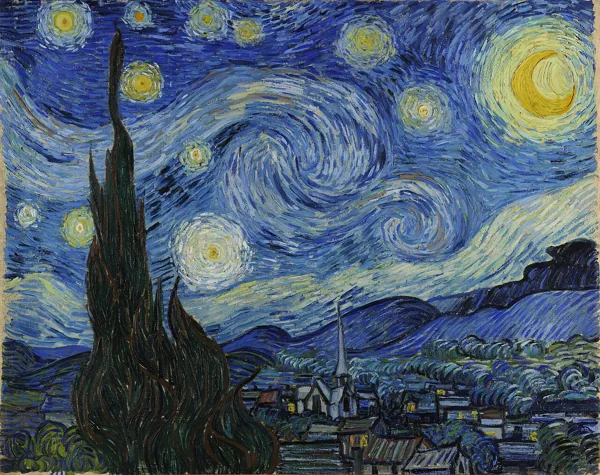

# Article Image Generator

Generate **original, web-ready illustrations for articles**: send an article title (and
optionally its content) and get back unique images, sized and compressed for the web, with
alt text.

Built on **FLUX.1-dev** running in **ComfyUI**, with a **local LLM (Qwen via Ollama)** that
turns the article into image prompts. Optionally give **reference images**: the service generates
new images in a similar style with **FLUX.1 Redux**, then checks with **DINOv2 + perceptual
hashing** that the results are not copies, regenerating them if needed. Everything runs on a
single GPU (tested on an RTX 4090, 24 GB).

| Title only (FLUX.1-dev) | | |
|---|---|---|
|  |  |  |
| *Metro số 1 TP.HCM chính thức vận hành thương mại* | *Giá cà phê xuất khẩu tăng mạnh, nông dân Tây Nguyên phấn khởi* | *How small cafés use AI to plan their weekly menu* |

| Reference image | + title, strength 0.3 (default) | |
|---|---|---|
|  |  |  |
| *The Starry Night* (public domain) | *Giá cà phê xuất khẩu tăng mạnh…* | *Metro số 1 TP.HCM…* |

## The problem

Content teams need an illustration for every article. Reusing photos from other sites risks
copyright claims and duplicate-content penalties; commissioning or shooting photos is slow and
expensive. This service produces a fresh, on-topic image in seconds.

| Input | Output |
|---|---|
| Article title (required) | 1–4 WebP images (`featured` 1200×630, `inline` 1200×800, `square` 1080×1080) |
| Article content / summary (optional) | Alt text for each image, in the article's language |
| Number of images, size preset, seed (optional) | The prompt and seed used, for reproducibility |
| Reference images + strength (optional) | Scores: CLIP prompt alignment; copy similarity to the references (originality check) |

## How it works

```
POST /v1/jobs ──► FastAPI ──► Redis queue ──► worker
                                                │
                     1. plan     Ollama (Qwen):     article ─► N image prompts + alt text
                     2. render   ComfyUI (FLUX.1-dev fp8): prompt [+ reference via Redux] ─► image
                                 (progress via WebSocket)
                     3. publish  crop/resize ─► WebP
                     4. check    DINOv2 + pHash vs references: a copy? ─► new seed, weaker
                                 reference, regenerate (max 2 retries); CLIP score vs prompt
                     5. save     /files/<job>/<slug>-N.webp
                                                │
GET /v1/jobs/{id} ◄── status, progress, image URLs + alt text
```

Design notes:

- **Workflow templates, not hard-coded node ids.** Each ComfyUI workflow is an API-format JSON
  export plus a small YAML manifest mapping friendly parameters (`prompt`, `seed`, `steps`…) to
  node inputs (`workflows/flux_txt2img.yaml`). A workflow can be re-exported from the ComfyUI
  editor without touching Python code.
- **One GPU, two models.** By default the stages time-share the GPU: ComfyUI is asked to unload
  (`POST /free`) before the LLM runs, and Ollama unloads right after answering (`keep_alive: 0`).
  This is required for larger LLMs (Qwen 3.6 27B ~17 GB + FLUX fp8 do not fit in 24 GB together);
  with the default Qwen 3.5 9B you can set `FREE_VRAM_BETWEEN_STAGES=false` to keep both loaded.
  The worker runs one job at a time.
- **Structured LLM output.** The LLM answers against a JSON schema (Ollama structured outputs),
  with validation and a retry.
- **Originality check, calibrated on real outputs.** A Redux result can end up reproducing its
  reference, which defeats the purpose (and the copyright concern). Each result is compared with
  every reference using **DINOv2** image embeddings (layout/structure) and perceptual hashes
  (pixel-level copies). If DINOv2 similarity > 0.60 or pHash distance < 12, the image is
  regenerated with a new seed and a 40 % weaker reference, up to 2 times; scores are returned so
  a human can review borderline cases. The first version used CLIP image similarity and missed
  copied compositions; see [Choosing the copy detector](#choosing-the-copy-detector).
- **Fail fast.** Reference images are downloaded/validated when the job is created (422 on bad
  input, private/loopback URLs rejected as a basic SSRF guard), and the worker checks through
  `/object_info` that ComfyUI has every model file a workflow needs before using the GPU.
- **Reproducible environment.** ComfyUI is pinned to a release tag; model weights are declared in
  `models.yaml` and downloaded by a script; everything starts with `docker compose`.

## Quick start (GPU server)

Requirements: NVIDIA GPU with ≥ 24 GB VRAM, NVIDIA driver ≥ 570 (or see below),
Docker + [NVIDIA Container Toolkit](https://docs.nvidia.com/datacenter/cloud-native/container-toolkit/install-guide.html),
disk space: ~30 GB where Docker stores images (`docker info -f '{{.DockerRootDir}}'`) and
~18 GB for model weights (`MODELS_DIR`).

```bash
git clone https://github.com/Tam1032/article-image-gen.git
cd article-image-gen
./scripts/setup.sh        # checks disk space, builds images, downloads FLUX (~17 GB) + Qwen (~7 GB), starts services
```

Then open the **demo UI** at `http://<server>:7860` or the API docs at `http://<server>:8000/docs`
(on a remote server: `ssh -L 7860:localhost:7860 -L 8000:localhost:8000 <server>`), or:

```bash
curl -X POST http://localhost:8000/v1/jobs \
  -H 'Content-Type: application/json' \
  -d '{"title": "Metro số 1 TP.HCM chính thức vận hành thương mại", "num_images": 2}'
# -> {"job_id": "…", "status": "queued", "status_url": "…/v1/jobs/…"}

curl http://localhost:8000/v1/jobs/<job_id>

# With a reference image (URL or data:image/...;base64 URI), 0.05-1.0 strength
curl -X POST http://localhost:8000/v1/jobs \
  -H 'Content-Type: application/json' \
  -d '{"title": "Du lịch Đà Lạt mùa hoa dã quỳ", "num_images": 2,
       "references": ["https://example.com/photo.jpg"], "reference_strength": 0.3}'
```

Each image in the result carries its scores:

```json
"scores": {
  "clip_score": 31.2,
  "originality": {"max_copy_similarity": 0.48, "max_clip_similarity": 0.77,
                  "min_phash_distance": 32, "passed": true, "attempts": 1}
}
```

### Reference images: FLUX.1 Redux (gated model)

1. Accept the license at <https://huggingface.co/black-forest-labs/FLUX.1-Redux-dev>.
2. Create a read token at <https://huggingface.co/settings/tokens> and set `HF_TOKEN=` in `.env`.
3. Download the extra weights (~1 GB): `./scripts/setup.sh`, or only the download step:
   `docker compose run --rm --no-deps -v "$MODELS_DIR:/app/models" -e HF_TOKEN api python scripts/download_models.py --models-dir /app/models`

Without the token everything else works; jobs with references fail with a clear message.

Settings live in `.env` (see `.env.example`). Older driver? Build ComfyUI with
`--build-arg TORCH_INDEX_URL=https://download.pytorch.org/whl/cu126`.
To watch or edit workflows in the ComfyUI editor, open an SSH tunnel:
`ssh -L 8188:localhost:8188 <server>` and browse `http://localhost:8188`. Drag a file from
`workflows/*.json` onto the canvas to open it; the queue panel shows jobs sent by the worker.

### Troubleshooting: disk space

`no space left on device` during the build means the disk holding Docker's data is full.

- Free space Docker can rebuild: `docker builder prune -af` (build cache) and
  `docker image prune -f` (old image versions left after a rebuild).

- Model weights and outputs can live on any disk: set `MODELS_DIR` and `DATA_DIR` in `.env`
  (e.g. `MODELS_DIR=/mnt/bigdisk/article-image-gen/models`).
- Docker images and the Ollama model live in Docker's data root. To move it to another disk,
  stop Docker, copy `/var/lib/docker` (and `/var/lib/containerd` if used) there, set
  `"data-root": "/mnt/bigdisk/docker"` in `/etc/docker/daemon.json` (keep existing keys such as
  the `nvidia` runtime), and start Docker again.

## Benchmarks (RTX 4090 24 GB, FLUX.1-dev fp8, 20 steps, Qwen 3.5 9B)

Measured with `scripts/benchmark.py`: 5 articles (Vietnamese and English, all three sizes), after a
warm-up job. Median (min–max).

**Latency and GPU memory, title only, 2 images per job**

| | GPU time-sharing (default) | Both models kept in VRAM |
|---|---|---|
| End-to-end per job | 51.1 s (50.4–54.7) | **40.4 s** (39.4–46.2) |
| LLM planning | **4.8 s** | 16.0 s |
| FLUX + post-processing per image | 23.3 s | **12.7 s** |
| Peak GPU memory | 19.3 GiB | 23.0 GiB |
| CLIP score (image vs prompt) | 30.1 | 30.2 |

Time-sharing reloads FLUX (17 GB) for every job, about 20 s; keeping both models loaded
removes that but leaves ~1 GB of VRAM free, and Ollama then appears to run part of the LLM on CPU,
so planning is slower. The default favours robustness (it also works with a 27B LLM);
`FREE_VRAM_BETWEEN_STAGES=false` is ~20 % faster with the 9B model.

**Reference strength: following the reference vs following the article** (1 reference, 5 articles each)

| `reference_strength` | CLIP score vs prompt | DINOv2 similarity to reference | What the images look like |
|---|---|---|---|
| no reference | 30.1 | 0.05 | — |
| **0.3** (default) | 28.6 | 0.48 (0.30–0.62) | Reference style, new scene from the article |
| 0.5 | 16.5 | 0.69 (0.64–0.75) | Reference composition reproduced |
| 0.8 | 12.7 | 0.71 (0.70–0.73) | Reference composition reproduced |
| 1.0 | 12.9 | 0.75 (0.73–0.82) | Reference composition reproduced |

| Reference | 0.3 | 0.5 | 1.0 |
|---|---|---|---|
|  |  |  |  |

*Du lịch Đà Lạt mùa hoa dã quỳ* with *The Starry Night* as the reference. Above 0.3 the cypress,
church and village of the painting come back regardless of the article.

### Choosing the copy detector

The first version flagged copies with CLIP image-image similarity (> 0.92). On the 25 Redux outputs
above it flagged none, although every image at strength ≥ 0.5 visibly reproduces the reference
layout. CLIP is trained to match captions, so "a starry-night painting with a village" scores
similarly whether the layout is copied or not: its values overlap (0.68–0.77 for good images at 0.3,
0.71–0.91 for copied layouts). Self-supervised **DINOv2** features keep structure and separate the two
groups (max 0.62 vs min 0.64), so the check now uses DINOv2 with a 0.60 threshold. With it, 20/20
images at strength ≥ 0.5 are flagged and regenerated, and 1/5 at 0.3 (the painting shown through a
window). This is calibrated on one reference and 25 images: treat the threshold as a starting
point and re-check it on your own references.

## API

| Method | Path | Description |
|---|---|---|
| `POST` | `/v1/jobs` | Create a generation job → `202` with `job_id` |
| `GET` | `/v1/jobs/{job_id}` | Status (`queued`, `planning`, `generating`, `completed`, `failed`), progress 0–1, images |
| `GET` | `/files/{job_id}/{file}` | Generated image |
| — | `:7860` | Gradio demo UI (client of the API) |
| `GET` | `/health` | Redis / ComfyUI / Ollama reachability |

## Development

```bash
uv sync
uv run pytest            # tests use fake LLM/ComfyUI/scorer, no GPU or model downloads
uv sync --group scoring --group ui   # optional: CLIP scoring (CPU torch) and the Gradio UI
```

Project layout:

```
app/
  main.py              FastAPI app
  worker.py            arq worker (one job at a time)
  pipeline.py          plan -> render -> publish
  jobs.py              job state in Redis
  ui.py                Gradio demo (talks to the API)
  services/
    llm.py             Ollama client + prompt writing
    comfy.py           ComfyUI HTTP/WebSocket client
    workflows.py       workflow templates + required-model listing
    references.py      reference image fetch/validation (SSRF guard)
    scoring.py         CLIP score; DINOv2/pHash copy detection
    postprocess.py     crop/resize/WebP
workflows/             ComfyUI API-format graphs + YAML manifests
docker/                Dockerfiles (API/worker, ComfyUI)
scripts/               setup, model download, benchmark
```

## Roadmap

- [x] Article → prompts → FLUX images → web-ready files, async job API, Docker
- [x] Reference images → new original image (FLUX Redux)
- [x] Originality check: CLIP / perceptual-hash similarity against reference images, auto-retry
- [x] Relevance score (CLIP image–text) per image
- [x] Gradio demo UI
- [x] Benchmarks on RTX 4090 (latency, VRAM, scores)
- [ ] Prompts that keep text out of images (FLUX sometimes renders signs with garbled text)
- [ ] Larger calibration set for the copy threshold (several references and styles)

## License notes

FLUX.1-dev and FLUX.1 Redux-dev weights are under the FLUX.1 [dev] Non-Commercial License. For commercial use,
switch to FLUX.1-schnell (Apache-2.0, listed as optional in `models.yaml`).
